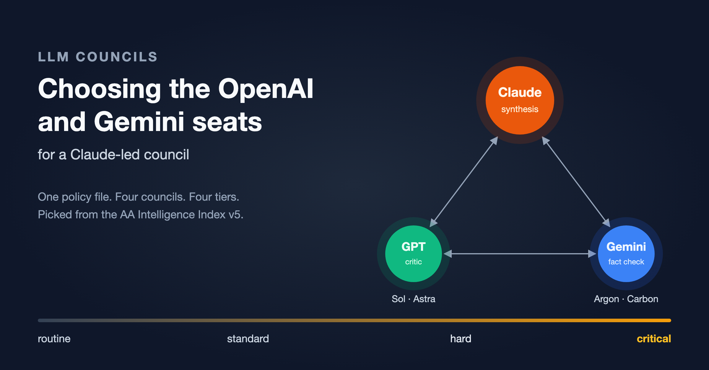
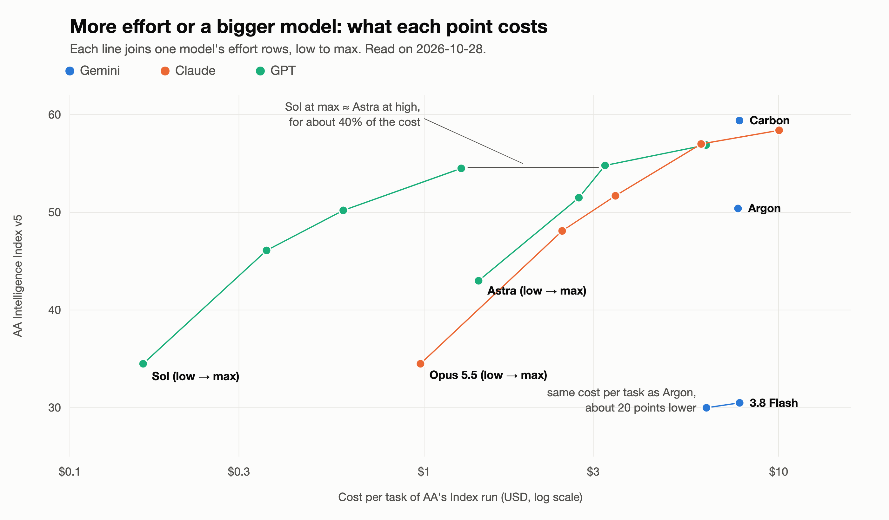
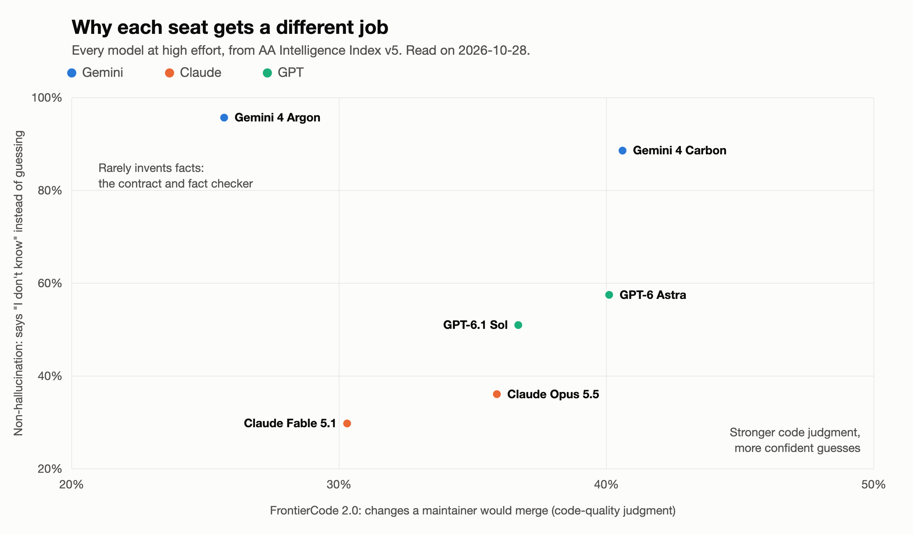

# LLM Councils: Choosing the OpenAI and Gemini Seats for a Claude-Led Council



***In this article, we work out which OpenAI and Gemini models belong next to Claude in an LLM Council at each level of task difficulty, and I share the repeatable technique behind the choice.***

## TL;DR

- **GPT-6.1 Sol at `max` is the best value on the GPT side.** It matches GPT-6 Astra at `high` on the Index (54.5 against 54.8) and on both coding tests, for about 40% of the cost. So Sol takes the hard tier, and Astra moves up to the critical tier.
- **The Gemini seat checks facts, not code.** Gemini 4 Argon says "I don't know" instead of guessing 96% of the time, the best rate on the board, but its FrontierCode 2.0 score (25.7) trails the GPT, Claude and Carbon rows at `high` (30.3 to 40.6). So it reviews contracts, facts and operational claims, and the GPT seat reviews the code.
- **The cheap-looking models are not cheap.** Gemini 3.8 Flash costs as much per task as Argon for about 20 fewer Index points, and Sol at `low` beats GPT-6 Luna at `max` for the same money. Flash stays only as a fallback, and Luna leaves the roster.
- **The roster:** Sol at rising effort for the routine, standard and hard tiers; Astra at `max` for the critical tier; Argon in every tier until Google serves Gemini 4 Carbon, the strongest model at `high`; Claude Opus 5.5 leads and writes the synthesis.
- **One file and one agent keep it current.** No council prompt names a model. They all read `MODEL-SELECTION.md`, and an agent that I run by name rewrites that file when a new model or a new benchmark arrives.

## Contents

- [The Council Setup](#the-council-setup)
- [The Analysis Technique](#the-analysis-technique)
- [What the Numbers Say](#what-the-numbers-say)
- [The Council at Each Difficulty](#the-council-at-each-difficulty)
- [Adjusting the Council for Each Kind of Task](#adjusting-the-council-for-each-kind-of-task)
- [Where the Numbers Stop](#where-the-numbers-stop)
- [Codifying the Technique](#codifying-the-technique)
- [Wrapping Up!](#wrapping-up)
- [Appendix A: Reading the AA Leaderboard Data](#appendix-a-reading-the-aa-leaderboard-data)
- [Appendix B: The Nine Metrics](#appendix-b-the-nine-metrics)
- [Appendix C: The Full Numbers](#appendix-c-the-full-numbers)

I use LLM Councils for the hard parts of my engineering work: the plan I write for every task that has more than a couple of pieces and steps, the data migration that can't go wrong, the architecture decision that the team will live with for years, and the code review that has to find the subtle concurrency bug. As you can see, there are various levels of difficulty here.

The Claude Code session leads each council and writes the synthesis, while one OpenAI model and one Gemini model review the same material independently through [my fork](https://github.com/rpeck/pal-mcp-server) of the PAL MCP server. PAL originally came from [BeehiveInnovations](https://github.com/BeehiveInnovations/pal-mcp-server), but they haven't been maintaining it, so I've stepped in. After that first independent round, the seats read and critique each other's answers, and the council goes around that loop until all three agree or it hits a limit, such as three or five times around; in my experience, they almost always come to full agreement before the fifth time around. If they hit the limit without agreeing, they report their disagreements to me so I can make a human choice. Each provider fails in its own way (in the DS/ML world we'd say they have uncorrelated errors), so the two outside seats catch mistakes that Claude Code misses on its own; that diversity is the whole reason to pay for three opinions instead of one.

A single policy file, `MODEL-SELECTION.md`, pins the model for each seat. None of my council prompts names a model; every council reads the policy file at the start of each run, so that file is the only thing I change when the roster changes. This week two releases made my file out of date. On October 27, Artificial Analysis (AA) replaced its Intelligence Index v4.3 with v5, which uses harder tests and keeps most of them private; on October 28, Google released Gemini 4 Carbon, which went straight to the top of the new Index. So I redid the analysis, and this time I saved the method a Claude Code agent, so that the next update follows the same steps. As I often say, laziness is the mother of invention! 🥱 ➡️ 😴

## The Council Setup

Before we look at any benchmark, it helps to know what the council can call, because a model that you can't reach is no use in a seat. The routes differ between my home laptop and my work at Tribe AI. Tribe is extremely careful to keep each client's work inside the LLM providers that the client has approved, so I extended my PAL fork to allow me to route each council through exactly those providers, with per-provider allow-lists that keep it from calling anything else, ensuring that no data leaks to non-approved models. The setup below is the one I used for this analysis. My councils have three seats:

| Seat | Role | Route |
|---|---|---|
| Claude Code session | lead, synthesis, final decision | direct, within Claude Code CLI or Claude Desktop |
| GPT seat | adversarial critic, code-level review | ChatGPT plan through the Codex CLI, via [my PAL fork](https://github.com/rpeck/pal-mcp-server) |
| Gemini seat | contract, fact and operations review | Gemini API key, read through the 1Password CLI, via my PAL fork |

My fork of PAL reaches OpenAI models through a ChatGPT plan, so the GPT seat can use only what the plan serves. On October 28 that was GPT-6.1 Sol, GPT-6 Astra and GPT-6 Luna; GPT-6.1 Terra hadn't reached the plan yet. The Gemini key served Gemini 4 Argon and the Flash models, but not Gemini 4 Carbon, because Google is giving first access to selected cyber-defense partners. That churn is why I wrote the update agent: refreshing the members of each tier as new models come out is now a three-minute job.

## The Analysis Technique

The technique has six parts, and we'll walk through them in order.

### Listing what the routes serve

A benchmark winner that your route can't call is obviously of no use, so the first job is an inventory. For the ChatGPT plan, Codex lists every model the plan serves:

```bash
codex debug models | jq -r '.models[] | "\(.slug)\t\(.visibility)"'
```

On the Gemini side I query the API's models list with my key, and I also read OpenRouter's public models API; it's never a council route for me (it's not in my allow-list for my work laptop), but new releases tend to show up there first.

### Getting the benchmark data

AA's leaderboard has one row per model and reasoning effort, for example "GPT-6.1 Sol (High)", with the Index value, the score on each test inside the Index and the cost of the Index run. Claude Code's web fetch tool misses most of those rows, so a short script reads the data that the page embeds; [Appendix A](#appendix-a-reading-the-aa-leaderboard-data) has the script and how it works.

### Choosing the metrics

My councils review plans, designs, measurements and, for the hard parts of a coding task, the code itself, and each kind of work leans on different results. That means the headline Index can't carry the decision alone, so I read nine columns: the Index, six test scores, the non-hallucination rate and the cost per task. [Appendix B](#appendix-b-the-nine-metrics) says what each one tells me about a seat.

No public benchmark measures architecture design directly. SWE-Atlas QnA and FrontierCode 2.0 come closest, so they carry the most weight for planning and review seats.

### Comparing models fairly

We do set a different effort for each task, but that comes later; to decide *which model* gets a seat, the comparison itself has to be fair. AA measured Carbon and Argon only at `high`, while it measured the GPT and Claude models at five efforts each, and putting Carbon at `high` next to Opus at `max` would compare two different amounts of thinking. So I make two comparisons: every model at `high`, which shows which model is stronger for the same amount of thinking, and every model at its best measured effort, which shows each model's ceiling. The effort that each seat runs at then comes from the task's difficulty and the kind of council, in the tier and council tables below.

### Building tiers by task difficulty

Most council decisions don't need the most expensive models, and the ones that do need them badly. So I sort the work into four tiers and pick one model and one effort per provider for each:

| Tier | Typical work | Selection rule |
|---|---|---|
| Routine | triage, data gathering, a quick second opinion | the cheapest row with an Index of about 35 or more |
| Standard | the default council decision | an Index of about 50 at the lowest cost |
| Hard | concurrency, data migrations, security boundaries, architecture decisions, any disagreement between seats | the highest Index within about 2.5 times the standard cost |
| Critical | irreversible or client-facing decisions | the best row the route serves |

### Council prompts as well-informed model routers

If you've worked with LLM gateways, you'll recognize this as a model router: each request goes to the cheapest model and effort that can handle it. In my setup, the council prompts do the routing, because they know the most about the task at hand. A router in front of an API usually has only the prompt text to go on; a council prompt gets a decision brief from the session that convened it, which says whether the step is routine, hard (a data migration, a security boundary, a disagreement between seats) or critical. The council maps that to a tier and calls PAL with the tier's model and effort, so the policy file supplies the routing table and each council prompt applies it.

### Applying three checks

The tier rules give a first draft, and three checks turn it into a roster. First, *dominance*: when a cheaper row matches a pricier one within about one Index point and on both coding tests, the cheaper row wins. Second, *heterogeneity*: I match each seat's role to its strongest metric and keep it away from its weakest, since a council only beats a single model when each seat does what it's best at. Third, *availability*: a model that its route doesn't serve goes on a waiting list and never into a tier, however good its numbers look.

## What the Numbers Say

The full tables, AA's v5 values as of 2026.10.28, are in [Appendix C](#appendix-c-the-full-numbers); the findings below quote the numbers that decide each seat.

### On the GPT side

The most useful finding on the GPT side is how close Sol gets to Astra. GPT-6.1 Sol at `max` matches GPT-6 Astra at `high` on the Index (54.5 against 54.8), on FrontierCode 2.0 (40.6 against 40.1) and on Terminal-Bench 4.0 (56.1 against 54.0), for about 40% of the cost. On a ChatGPT plan that's 40% of the quota, so Sol at `max` takes the hard tier, and Astra moves up to the critical tier, where its `max` row is the best GPT result on the board.



Luna drops off the roster entirely. Sol at `low` scores 34.5 for $0.16 a task, while Luna at `max` scores 27.8 for $0.15, so for the same money Sol makes a better routine seat.

### On the Gemini side

Gemini 3.8 Flash looks like the budget pick, and per token it is; however, it spends more tokens per task, so AA's cost per task for Flash comes out the same as Argon's, for about 20 fewer Index points. Flash stays only as the fallback for when Argon is overloaded.

The non-hallucination column, which comes from AA-Omniscience (the knowledge test inside AA's Index), makes the strongest case for the Gemini seat. When Argon doesn't know an answer, it says so 96% of the time instead of guessing, and Carbon does it 89% of the time; Sol and Astra sit between 48% and 58%, and the Claude models between 30% and 50%. On the other hand, Argon's FrontierCode 2.0 score of 25.7 trails every other model here by a wide margin. Together, those two facts define the Gemini seat's job; it checks contracts, interfaces, facts and operational claims, and it leaves line-level code quality to the GPT seat.



Carbon is the strongest model on the board at `high`, although most people can't call it yet, since Google is giving first access to selected cyber-defense partners. It leads the Index, FrontierCode 2.0 and Terminal-Bench 4.0 at that effort, while Astra and Sol lead CritPt and Argon leads non-hallucination. AA hasn't measured Carbon at `max` yet, so its ceiling is still an open question.

### On the Claude side

Fable 5.1 and Opus 5.5 lead SWE-Atlas QnA, the closest thing we have to a planning and architecture benchmark, which is one more reason the Claude session writes the synthesis. Between the two, Opus 5.5 at `high` beats Fable 5.1 at `high` on the Index (51.7 against 47.0) at less than half the cost per task; Fable's half-point lead on SWE-Atlas QnA (66.4 against 65.9) makes it a good choice for a council that spends its time asking questions about a large codebase.

## The Council at Each Difficulty

Put together, the tier rules and the three checks give this roster:

| Tier | GPT seat | Gemini seat | Claude session |
|---|---|---|---|
| Routine | GPT-6.1 Sol, `low` or `medium` | Gemini 4 Argon, `medium` | any model (I use Opus) |
| Standard | GPT-6.1 Sol, `high` | Gemini 4 Argon, `high` | Claude Opus 5.5, `high` |
| Hard | GPT-6.1 Sol, `max` | Gemini 4 Argon, `max` | Claude Opus 5.5, `xhigh` |
| Critical | GPT-6 Astra, `max` | Gemini 4 Carbon, `high` (Gemini 4 Argon at `max` until Google serves it) | Claude Opus 5.5, `max` |

Two models sit on the waiting list. Carbon takes the critical Gemini seat as soon as the Gemini API serves it with my key, and a daily check watches for that. GPT-6.1 Terra at `max` scores 51.0, with 42.3 on FrontierCode 2.0, for $0.96 a task; once my ChatGPT plan serves it, I'll test it against Sol at `max` for the hard tier.

## Adjusting the Council for Each Kind of Task

I don't run one council, I run four: a coding council for the hard parts of a coding task, a code-review council for sweeps across a codebase, an architecture council for design decisions, and a data-science council for evaluation and measurement work. Each one leans on different columns, so the difficulty tiers are only the default, and each council gets its own adjustments on top of them:

| Council | Metrics that decide | Standard | Hard | Critical | Once Google serves Carbon |
|---|---|---|---|---|---|
| Coding | FrontierCode 2.0, Terminal-Bench 4.0 | Sol `high` + Argon `high` | Sol `max` + Argon `max` | Astra `max` + Argon `max` | Carbon replaces Argon from the standard tier up |
| Code review | FrontierCode 2.0, SWE-Atlas QnA | Sol `high` + Argon `high` | Sol `max` + Argon `max` | Astra `max` + Argon `max` | Carbon replaces Argon from the standard tier up |
| Architecture | SWE-Atlas QnA, CritPt, HLE-Diamond, non-hallucination | Sol `high` + Argon `high` | Sol `max` + Argon `max` | Astra `max` + Argon `max` | Carbon at the hard and critical tiers; Argon stays at standard |
| Data science | Terminal-Bench-Science, CritPt, HLE-Diamond, non-hallucination | Sol `max` + Argon `high` | Astra `high` + Argon `max` | Astra `max` + Argon `max` | Carbon at the hard and critical tiers; Argon stays at standard |

Routine work looks the same in every council, so it doesn't get a column.

### Where Sol at high falls short

The data-science council starts one step up on the GPT side. Its work depends on Terminal-Bench-Science (agentic science and data work in a terminal) and HLE-Diamond (hard expert questions), and Sol at `high` is weak on both; Sol at `max` closes most of the gap to Astra for a fraction of the cost:

| Model, effort | Terminal-Bench-Science | HLE-Diamond | CritPt v2 (hard) | Cost per task |
|---|---|---|---|---|
| GPT-6.1 Sol, high | 46.2 | 51.9 | 67.5 | $0.59 |
| GPT-6.1 Sol, max | 58.1 | 58.8 | 68.5 | $1.27 |
| GPT-6 Astra, high | 59.5 | 59.3 | 71.5 | $3.24 |
| GPT-6 Astra, max | 63.3 | 63.8 | 70.5 | $6.24 |
| Gemini 4 Argon, high | 52.9 | 56.7 | 52.5 | $7.68 |
| Gemini 4 Carbon, high | 64.8 | 69.1 | 63.0 | $7.76 |

So Sol at `max` becomes the data-science council's standard row, and Astra at `high`, at about 2.5 times that cost, takes its hard tier.

### When Carbon comes

On the Gemini side, the question is when Carbon should replace Argon once Google opens it up. AA puts their cost per task within a few cents of each other, and Carbon beats Argon on every column except non-hallucination (89% against 96%). Its biggest gain is on FrontierCode 2.0 (40.6 against 25.7), which is the metric the coding and code-review councils care about most, so Carbon takes their Gemini seats from the standard tier up. The architecture and data-science councils use their Gemini seats mostly to state facts, limits and definitions, where Argon's 96% is the best rate on the board; there, Argon keeps the standard tier, and Carbon takes over where the reasoning gets hard.

### Coding council seat assignments

The same numbers decide who does what here: the Gemini seat reviews the contract (interfaces, data shapes, migrations and backfills), and the GPT seat reviews the code itself, which keeps Argon away from the line-level quality calls that its FrontierCode score warns about.

## Where the Numbers Stop

A few caveats keep this table in perspective. AA measured Carbon and Argon only at `high`, so every cross-provider comparison at `max` is incomplete. The coding-agent page mixes each model with its vendor's agent, which is why I use it only for SWE-Atlas QnA. AA's cost is an API cost, and a ChatGPT plan bills in quota instead; the relative cost still predicts how fast a model uses up the quota, though. AA v5 is also only a day old, and AA can still add rows and adjust values. Finally, no public benchmark runs on your codebase, so these numbers tell you which models are worth testing on your own work, and your own work decides the rest.

## Codifying the Technique

Redoing this by hand every time a lab releases a model gets old fast, so the method now lives in a Claude Code agent called `update-MODEL-SELECTION`. It runs only when I call it by name, because I want a human in the loop whenever council seats change. When I invoke it, it inventories the routes, reads the current AA data using the script in Appendix A, builds the comparison tables, applies the tier rules and the three checks, and updates the policy file. It asks me before it touches the PAL configuration itself.

That makes the whole workflow one step: I run `update-MODEL-SELECTION`, it rewrites `MODEL-SELECTION.md`, and every council picks up the new roster on its next run. The four council prompts never change, because they don't name a single model. Each one describes its seats' roles and how to classify a decision's difficulty, and at the start of every run it reads each seat's model and effort from `MODEL-SELECTION.md`. The council calls in my other projects work the same way, so they never need an edit either.

## Wrapping Up!

Ok, that's enough for today! We covered the council setup, a six-part technique for picking the outside seats, and the October 2026 roster: GPT-6.1 Sol at rising effort for the routine, standard and hard tiers, GPT-6 Astra at `max` for the critical tier, and Gemini 4 Argon in every tier until Gemini 4 Carbon opens up. On top of that default, each council gets its own adjustments: the data-science council starts Sol at `max` and brings Astra in at the hard tier, and Carbon will take the coding and code-review councils' Gemini seats first. The Gemini seat checks facts and contracts, the GPT seat challenges the code and the reasoning, and Claude writes the synthesis. Later articles in this LLM Councils series go into how my councils grew from copy-and-paste into this setup, and what they've caught along the way.

As always, please comment below with any questions, corrections, or the council setup you use yourself. If you liked this, please clap and follow me here and on LinkedIn. See you next time! 🤓

## Appendix A: Reading the AA Leaderboard Data

AA's leaderboard has one row per model and reasoning effort, for example "GPT-6.1 Sol (High)", with the Index value, the score on each test inside the Index and the cost of the Index run. The trouble is that the web fetch tool in Claude Code truncates the page and misses most of the rows; however, the page embeds its data as JSON inside script tags, so a short script reads all of it:

```python
"""Read per-effort benchmark rows from the Artificial Analysis leaderboard page."""
import json
import re
import urllib.request

URL = "https://artificialanalysis.ai/leaderboards/models"
ROW = re.compile(
    r'\{"slug":"(?P<slug>[^"]+)","name":"(?P<name>[^"]+)","shortName"[^{}]*?'
    r'"intelligenceIndex":(?P<index>[^,]+),[^{}]*?"scores":(?P<scores>\{[^{}]*\})'
    r'(?:[^{}]*?"intelligenceIndexCostPerTask":(?P<cost>[0-9.]+|null))?'
)
METRICS = {
    "frontiercode-2-0": "FrontierCode 2.0",
    "terminalbench-4-0": "Terminal-Bench 4.0",
    "critpt-v2-hard": "CritPt v2 (hard)",
    "omniscience-non-hallucination": "Non-hallucination",
}


def fetch(url: str) -> str:
    request = urllib.request.Request(url, headers={"User-Agent": "Mozilla/5.0"})
    with urllib.request.urlopen(request) as response:
        # The page embeds its data as escaped JSON inside script tags.
        return response.read().decode("utf-8").replace('\\"', '"')


def rows(page: str, wanted: tuple[str, ...]):
    seen = set()
    for match in ROW.finditer(page):
        if match["slug"] in seen or match["index"] == "null" or not match["name"].startswith(wanted):
            continue
        seen.add(match["slug"])
        scores = json.loads(match["scores"])
        cost = match["cost"]
        yield {
            "model": match["name"],  # for example "GPT-6.1 Sol (High)"
            "index": round(float(match["index"]), 1),
            "cost_per_task": float(cost) if cost not in (None, "null") else None,
            **{label: scores.get(key) for key, label in METRICS.items()},
        }


if __name__ == "__main__":
    page = fetch(URL)
    for row in rows(page, ("GPT-6", "Gemini 4", "Gemini 3.8", "Claude Opus 5.5", "Claude Fable 5.1")):
        print(row)
```

The regex keys on the row's own fields (`slug`, `name`, `intelligenceIndex`, `scores`) instead of on the page layout around them, which keeps it working when AA rearranges the page; it still depends on how AA serializes the rows, though, so expect to touch the pattern now and then. The `seen` set matters because the page repeats each row in several charts, and the `null` check drops models that AA lists but hasn't scored on this Index version yet. AA's coding-agent page works the same way: it measures each model inside its vendor's agent (Claude Code, Codex or Antigravity) on three tests, and one of them, SWE-Atlas QnA, appears only there.

## Appendix B: The Nine Metrics

| Metric | What it tells me about a seat |
|---|---|
| AA Intelligence Index v5 | general reasoning level |
| FrontierCode 2.0 | code-quality judgment: a change passes only if a maintainer would merge it |
| Terminal-Bench 4.0 | long agentic work in a terminal |
| Terminal-Bench-Science | agentic science and data work in a terminal |
| SWE-Atlas QnA | questions about an existing codebase, the nearest measure to planning and architecture review |
| CritPt v2 (hard) | hard, novel reasoning problems |
| HLE-Diamond | hard expert questions across many fields |
| Non-hallucination rate | from AA-Omniscience: how often the model says "I don't know" instead of giving a wrong answer |
| Cost per task | AA's API-equivalent cost; on a ChatGPT plan it predicts how fast a model uses up the quota |

## Appendix C: The Full Numbers

These are AA's v5 values as of 2026.10.28. FrontierCode 2.0, Terminal-Bench 4.0, CritPt and non-hallucination are percentages.

| Model, effort | Index | FrontierCode 2.0 | Terminal-Bench 4.0 | CritPt v2 (hard) | Non-hallucination | Cost per task |
|---|---|---|---|---|---|---|
| GPT-6.1 Sol, low | 34.5 | 20.2 | 30.8 | 59.5 | 50 | $0.16 |
| GPT-6.1 Sol, high | 50.2 | 36.7 | 51.5 | 67.5 | 51 | $0.59 |
| GPT-6.1 Sol, max | 54.5 | 40.6 | 56.1 | 68.5 | 48 | $1.27 |
| GPT-6 Astra, high | 54.8 | 40.1 | 54.0 | 71.5 | 58 | $3.24 |
| GPT-6 Astra, max | 56.9 | 42.4 | 59.1 | 70.5 | 50 | $6.24 |
| GPT-6 Luna, max | 27.8 | 25.2 | 12.6 | 41.5 | 21 | $0.15 |
| Gemini 4 Argon, high | 50.4 | 25.7 | 57.1 | 52.5 | 96 | $7.68 |
| Gemini 4 Carbon, high | 59.4 | 40.6 | 65.2 | 63.0 | 89 | $7.76 |
| Gemini 3.8 Flash, high | 30.5 | 18.7 | 19.7 | 43.5 | 45 | $7.77 |
| Claude Opus 5.5, high | 51.7 | 35.9 | 56.6 | 58.0 | 36 | $3.46 |
| Claude Opus 5.5, max | 58.4 | 46.4 | 59.6 | 61.0 | 50 | $10.04 |
| Claude Fable 5.1, high | 47.0 | 30.3 | 52.0 | 60.5 | 30 | $7.56 |

SWE-Atlas QnA comes from the coding-agent page, with each model inside its vendor's agent at its best measured effort:

| Agent and model | SWE-Atlas QnA |
|---|---|
| Claude Code, Claude Fable 5.1 (max) | 66.4 |
| Claude Code, Claude Opus 5.5 (max) | 65.9 |
| Antigravity CLI, Gemini 4 Carbon (high) | 63.7 |
| Codex, GPT-6.1 Sol (max) | 59.9 |
| Codex, GPT-6 Astra (max) | 59.1 |
| Antigravity CLI, Gemini 4 Argon (high) | 55.1 |
